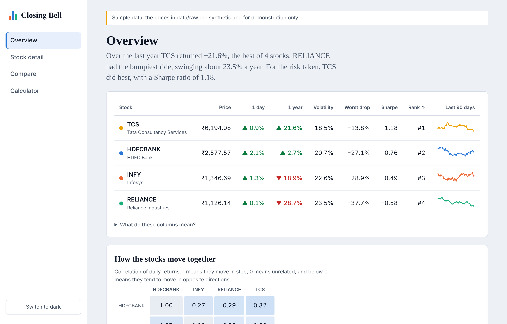
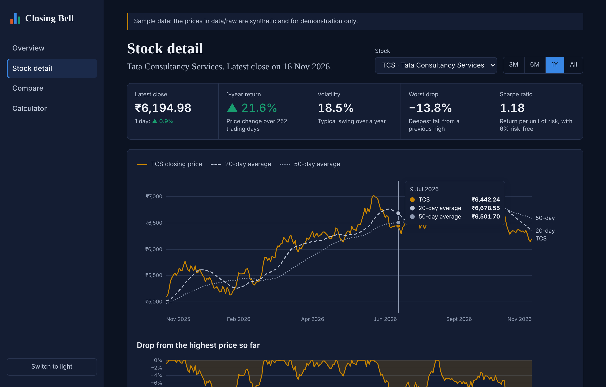
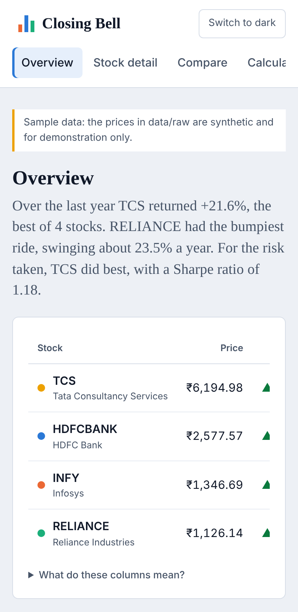

# Closing Bell

A stock analysis dashboard for Indian large-cap stocks. **R** calculates returns, volatility, drawdown, Sharpe ratio and correlations. **HTML, CSS and JavaScript** show them. Prices refresh by themselves every day.

[](https://YOUR-PROJECT.vercel.app)
[](https://github.com/pranshu613/R-project/actions/workflows/refresh-data.yml)

**Live demo: <https://YOUR-PROJECT.vercel.app>**



| Stock detail (dark theme) | On a phone |
|---|---|
|  |  |

## What it shows

- **Overview**: sortable table, a one-line summary, and a correlation grid.
- **Stock detail**: price chart with 20 and 50 day averages, a drop-from-peak chart, and a data table. Hover for exact values.
- **Compare**: two stocks rebased to 100, side by side.
- **Calculator**: SIP and one-time investment growth, in the browser only.

The prices in the repo to begin with are synthetic demo data, and the page says so at the top. The banner disappears once real prices are downloaded.

## How the daily refresh works

Vercel serves static files and cannot run R. So a GitHub Actions job does the work and Vercel simply redeploys.

```
every day, 17:00 IST
  GitHub Actions
    R/download_real_data.R   → adds the latest close to data/raw/*.csv
    R/analysis.R             → writes web/data.json
    commits the changes      → Vercel redeploys on the push
  Browser
    reloads data.json every hour and when you return to the tab,
    and redraws only if the data changed
```

## Set it up

### 1. Get a free price API key

Create a free key at <https://www.alphavantage.co/support/#api-key>. The free plan returns the latest 100 trading days per request, so the app saves each day's prices into `data/raw/*.csv` and the history grows over time.

Indian stocks use the `.BSE` suffix there (for example `RELIANCE.BSE`). Check the symbols in `R/download_real_data.R` against the API before relying on them.

### 2. Put the project on GitHub

1. Create a new repository and upload **all** files, including the `.github` folder.
   - The `.github` folder is hidden on many systems. Upload by drag and drop, or use `git push`, so it is not missed.
2. In the repository go to **Settings → Secrets and variables → Actions → New repository secret**. Name it `ALPHAVANTAGE_KEY` and paste your key.
3. Go to **Settings → Actions → General → Workflow permissions** and choose **Read and write permissions**.
4. Open the **Actions** tab, choose **Refresh data**, and press **Run workflow** to fetch real prices straight away.

### 3. Publish on Vercel

1. On <https://vercel.com> choose **Add New → Project** and import the repository.
2. Leave the settings as they are. `vercel.json` already sets the output folder to `web` and skips the build.
3. Press **Deploy**.

Each daily data commit redeploys the site automatically. After this, replace `pranshu613`, `R-project` and `YOUR-PROJECT` in this README with your real names.

Notes:
- The workflow commits as the repository owner, because the Vercel Hobby plan does not deploy commits from other authors.
- GitHub can pause scheduled workflows after 60 days without repository activity. Press **Run workflow** once to wake it.
- The schedule is in `.github/workflows/refresh-data.yml` (`30 11 * * *` is 17:00 IST). Times are in UTC.

## Run it on your own computer

1. Install R from <https://cran.r-project.org> and the package: `install.packages("jsonlite")`.
2. Open the folder in VS Code and install the suggested extensions (R and Live Server).
3. To use real prices, set your key and download:
   ```
   export ALPHAVANTAGE_KEY=your-key       # Windows PowerShell: $env:ALPHAVANTAGE_KEY="your-key"
   Rscript R/download_real_data.R
   ```
4. Calculate: `Rscript R/analysis.R`
5. Right-click `web/index.html` → **Open with Live Server**. A plain double-click does not work, because the page loads `data.json` with `fetch()`.

## Project layout

```
.github/workflows/refresh-data.yml   daily job
R/analysis.R                         calculations, writes web/data.json
R/download_real_data.R               downloads and stores prices
data/raw/*.csv                       one file per stock (Date, Close)
web/index.html, style.css, script.js the dashboard
web/data.json                        the only link between R and the page
vercel.json                          static hosting settings
```

To add a stock, add it to `symbols` in `download_real_data.R` and to `stock_names` in `analysis.R`.

## If something goes wrong

| Problem | Fix |
|---|---|
| The workflow fails with "Set the ALPHAVANTAGE_KEY" | Add the secret in step 2. |
| The workflow cannot push | Turn on read and write permissions in step 3. |
| "No stock could be downloaded" | The key hit its daily limit, or a symbol is not known to the API. Check the log. |
| The site did not update | Check the **Actions** tab for a new commit, then the **Deployments** tab on Vercel. |
| Page shows "Could not load data.json" | Use Live Server locally, and check that `web/data.json` exists. |

## Disclaimer

For learning and demonstration. Prices may be delayed or wrong, and nothing here is financial advice.
